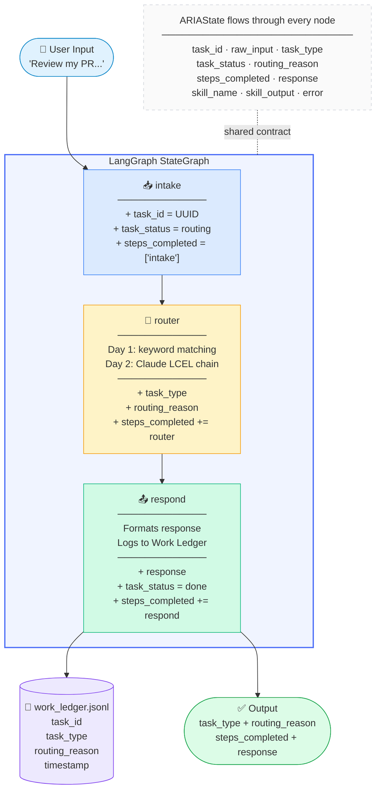
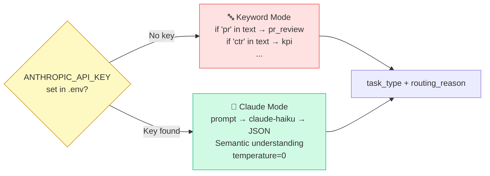
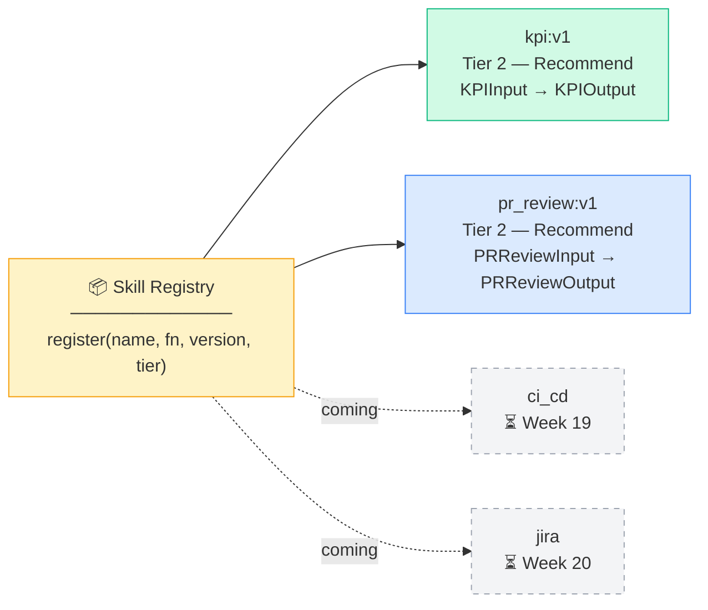
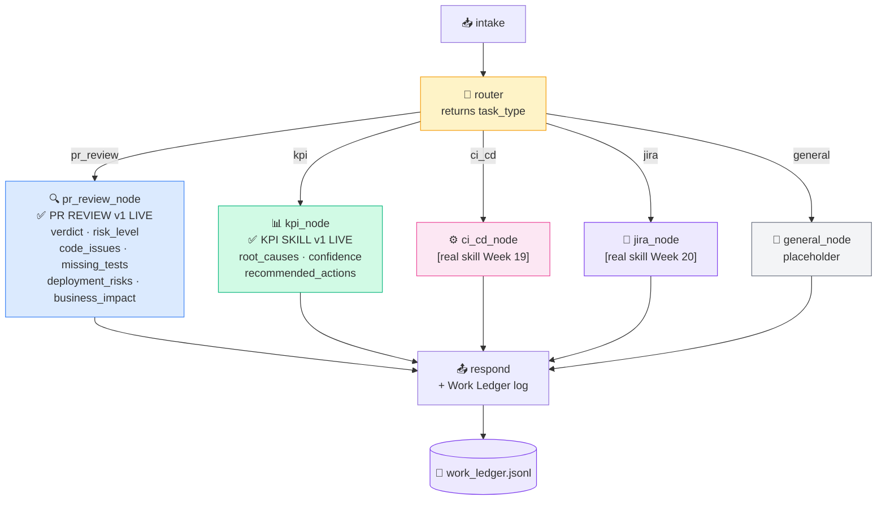

# ARIA — System Flow Diagram
# Updated at every build step. Open with VS Code Markdown Preview to see rendered diagram.
# Tip: Install "Markdown Preview Mermaid Support" extension for best rendering.

---

## Current Build State: Week 12 — Institutional Memory Live

---

## Router Mode (auto-detected)

---

## ARIAState — Fields & Ownership

```mermaid
flowchart LR
    subgraph INTAKE_BOX["intake node"]
        F1["task_id: UUID"]
        F2["task_status: 'routing'"]
        F3["steps_completed: ['intake']"]
    end

    subgraph ROUTER_BOX["router node"]
        F4["task_type: pr_review / kpi / ci_cd / jira / general"]
        F5["routing_reason: why this skill"]
        F6["steps_completed += 'router'"]
    end

    subgraph RESPOND_BOX["respond node"]
        F7["response: formatted text"]
        F8["task_status: 'done'"]
        F9["steps_completed += 'respond'"]
    end

    subgraph USER_BOX["set by caller"]
        F10["raw_input: user's message"]
    end

    USER_BOX --> INTAKE_BOX --> ROUTER_BOX --> RESPOND_BOX

    style INTAKE_BOX fill:#dbeafe,stroke:#3b82f6
    style ROUTER_BOX fill:#fef3c7,stroke:#f59e0b
    style RESPOND_BOX fill:#d1fae5,stroke:#10b981
    style USER_BOX fill:#e0f2fe,stroke:#0284c7
```

---

## Build History

| Step | What was built | Diagram impact |
|---|---|---|
| Step 1 | `aria/state.py` — ARIAState TypedDict | All state fields defined |
| Step 2 | `aria/nodes/intake.py` | intake node added |
| Step 3 | `aria/nodes/router.py` v1 | router node (keyword mode) |
| Step 4 | `aria/nodes/respond.py` | respond node added |
| Step 5 | `aria/graph.py` | Graph wired: intake→router→respond→END |
| Step 6 | `main.py` | Entry point, 5 test inputs |
| Step 7 | `aria/config.py` | LangSmith tracing (auto on/off) |
| Step 8 | `day2_lcel_test.py` | Standalone Claude chain (learning artifact) |
| Step 9 | `aria/nodes/router.py` v2 | Router: keyword fallback + Claude mode |
| Step 10 | `aria/work_ledger.py` | Work Ledger logging added to respond |
| Step 11 | `aria/skills/skill_registry.py` | Skill Registry — register(), get(), SkillMetadata |
| Step 12 | `aria/skills/kpi_skill.py` | KPI Investigation — KPIInput, KPIOutput, Eval-Lite |
| Step 13 | `aria/skills/pr_review_skill.py` | PR Review — PRReviewInput, PRReviewOutput, Eval-Lite |
| Step 14 | `aria/nodes/skill_nodes.py` v3 | Both kpi_node + pr_review_node call real skills |
| Step 15 | `aria/artifact_engine.py` | Formats typed skill output into shareable artifact cards |
| Step 16 | `aria/nodes/respond.py` v3 | Calls artifact_engine — raw JSON replaced by formatted output |
| Step 17 | `aria/knowledge/ingestion.py` | Chunk + embed + store in Chroma (sentence-transformers, in-memory) |
| Step 18 | `aria/knowledge/retriever.py` | Basic RAG + HyDE + Self-RAG + Adaptive RAG strategies |
| Step 19 | `aria/knowledge/seed_docs/` | Amar Ujala domain docs: KPI runbook + PR guidelines |
| Step 20 | `week9_rag_test.py` | Standalone test: ingest → retrieve → compare strategies (learning artifact) |
| Step 21 | `aria/knowledge/code_intel.py` | AST parser: extract functions, classes, imports; dependency graph builder; `ingest_repo()` |
| Step 22 | `week10_code_intel_test.py` | Code Q&A: ARIA indexes her own 20 files (46 functions, 12 classes) and answers questions about her codebase |
| Step 23 | `aria/memory/models.py` | Pydantic schemas: SessionMemory, TaskMemory, UserMemory, OutcomeMemory |
| Step 24 | `aria/memory/store.py` | File-backed JSON warm store: write, read_by_type, delete, clear_session |
| Step 25 | `aria/memory/manager.py` | MemoryManager: remember/recall/record_outcome/end_session/format_for_prompt |
| Step 26 | `week11_memory_test.py` | Memory lifecycle: 10 records written, recall verified, session promoted to Chroma cold |
| Step 27 | `aria/memory/models.py` v2 | Added DecisionMemory + ArtifactMemory to MemoryType union |
| Step 28 | `aria/memory/store.py` v2 | Added query_outcomes(), query_artifacts(), query_decisions(), roi_summary() |
| Step 29 | `aria/memory/manager.py` v2 | Added record_decision(), store_artifact(), get_artifact(), query_outcomes(), search_memory(), roi_snapshot() |
| Step 30 | `week12_institutional_memory_test.py` | Decision records, artifact linkage, outcome querying, semantic search, ROI snapshot |

---

## Skill Registry — What's Registered

---

## Graph — Week 7 (Two Real Skills)

---

## Coming Next — Week 8 (Artifact Engine)
